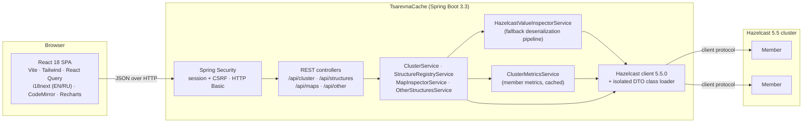

# TsarevnaCache

**A lightweight administration, monitoring and data inspection console for Hazelcast 5.5 clusters.**

TsarevnaCache connects to an existing cluster as a regular Hazelcast client and gives you a secured
web UI plus a REST API to watch members and memory, browse every distributed data structure and
read, edit or delete IMap entries — including entries whose Java classes the admin service has
never seen.


> **Non-commercial software.** TsarevnaCache is licensed under the
> [PolyForm Noncommercial License 1.0.0](LICENSE). Commercial use requires prior written permission
> from the author. See [License](#license).

---

## Contents

- [Project overview](#project-overview)
- [Features](#features)
- [Architecture](#architecture)
- [How custom DTO deserialization works](#how-custom-dto-deserialization-works)
- [Getting started](#getting-started)
- [Configuration](#configuration)
- [REST API](#rest-api)
- [Localization (EN / RU)](#localization-en--ru)
- [Development](#development)
- [Security notes](#security-notes)
- [Limitations](#limitations)
- [License](#license)

---

## Project overview

Hazelcast Management Center is powerful but heavy, and the open source Hazelcast distribution
ships without a data browser. Day-to-day questions — *"what is actually stored under this key?"*,
*"which map eats the memory?"*, *"why does this value not deserialize?"* — usually end in ad-hoc
client code.

TsarevnaCache answers them from a single self-contained jar:

- It runs **next to** your cluster as a Hazelcast client; nothing is installed on the members.
- It **never crashes on unknown data**: values whose classes, factories or serializers are missing
  are shown with a precise explanation instead of an error page.
- It is **safe for large maps**: it never calls `entrySet()` or `values()` without limits and pages
  through data with cost proportional to the page size.
- The UI is a dark, GitKraken-inspired single-page application available in **English and
  Russian**.

## Features

**Cluster & memory monitoring**
- Connection status (Online/Offline), cluster name, client and cluster versions.
- Members with address, UUID, master and lite-member flags, Hazelcast version, JVM heap and uptime.
- Totals over all maps: entries, owned and backup entry memory; top 5 heaviest maps (chart and table).

**Data structures registry**
- All distributed objects grouped by type: `IMap`, `ReplicatedMap`, `MultiMap`, `IQueue`, `ISet`,
  `IList`, `ITopic`, Reliable Topic, `FlakeIdGenerator`.
- Sidebar tree with name filter and size / memory badges; Hazelcast internal objects (`__*`) on demand.

**IMap inspector & CRUD**
- Data browser with three modes: all entries (cursor paging), exact key lookup (String, Long,
  Integer, UUID, JSON or a custom class key) and Hazelcast **SQL predicates**
  (e.g. `age > 25 AND active = true`).
- Table with key, key type, value preview, memory cost, hits and TTL / expiration.
- **Entry Inspector** drawer: JSON editor with syntax highlighting, `EntryView` metadata (cost,
  creation / update / access / store times, version, hits, TTL, max idle), *Save (put)* with an
  optional TTL and *Delete*.
- *Put Entry* dialog with key and value types (`STRING`, numbers, `BOOLEAN`, `UUID`, `BIG_DECIMAL`,
  `JSON` → `HazelcastJsonValue`, `CLASS` → your DTO), TTL in seconds.
- Editing **Compact records without their Java class** (the schema of the stored value is reused).
- *Evict All* and *Clear Map* (the map name has to be typed to confirm).
- **Memory & Performance Stats**: `LocalMapStats` aggregated over all members — owned / backup
  entries and memory, heap cost, Merkle trees cost, hits, get / put / set / remove counts and
  latencies, events, evictions, expirations, queries, near cache statistics and a per-member breakdown.

**Other structures**
- Size and the first 50 items of queues, sets, lists, multimaps and replicated maps; remove single
  items or clear the structure.

**Platform**
- Single built-in administrator account, session login for the UI, HTTP Basic for scripts.
- English (default) and Russian UI; the choice is remembered per browser.
- One executable jar: the UI is built by Maven and served by Spring Boot.

## Architecture



**Backend** (`src/main/java/io/github/noproblem2000/tsarevnacache`)

| Package | Responsibility |
|---|---|
| `config` | Hazelcast client (`HazelcastClientConfig`), isolated `DtoClassLoader`, SPA resource handling, configuration properties |
| `security` | Session login, cookie based CSRF for the SPA, HTTP Basic, JSON 401/403 bodies |
| `inspector` | `HazelcastValueInspectorService`: reading and writing keys/values, `GenericRecord` support, Compact record builder, unresolved object analysis, key references |
| `maps` | `MapInspectorService`: statistics, cursor scan, SQL predicate paging, entry views, put / delete / evict / clear |
| `metrics` | `ClusterMetricsService`: per-member metrics read through the Management Center client protocol |
| `cluster`, `structures` | Cluster overview, distributed object registry, queues / sets / lists / multimaps / replicated maps |
| `api` | REST controllers, DTOs, error codes and the global exception handler |

**Frontend** (`frontend/src`): `api` (typed client and DTO mirrors), `auth`, `components`
(layout, UI kit, charts, JSON editor), `features` (data browser, inspector, statistics, structures),
`pages`, `i18n`.

### Design decisions

- **Raw protocol reads.** IMap reads use the client protocol at the level of serialized `Data`
  (`MapFetchKeys`, `MapKeySetWithPagingPredicate`, `MapGetEntryView`). Every key and value is then
  decoded individually by the inspector, so one undecodable entry cannot break a page.
- **Cursor paging for unfiltered browsing.** A `PagingPredicate` without a filter makes the members
  scan and sort the whole map for every page. The unfiltered browser therefore iterates partitions
  with an opaque cursor; its cost is proportional to the page size. SQL predicate searches use
  `Predicates.sql(...)` wrapped in `Predicates.pagingPredicate(...)` as usual.
- **Statistics from member metrics.** Hazelcast clients cannot call `IMap.getLocalMapStats()`.
  Members publish their metrics (map, queue, multimap, replicated map statistics, JVM heap) for
  Management Center; TsarevnaCache reads the newest sample of every member with the same client
  message (`MCReadMetricsCodec`) and caches it for a few seconds.
- **Key references.** Every listed entry carries a `keyRef` — the URL-safe Base64 of the serialized
  key. Get, put and delete accept it, which addresses the exact stored key even when its class is
  unknown to the admin service.
- **Writes without reading old values.** Puts use `IMap.set` and deletes `IMap.delete`, so old values
  that cannot be decoded never get in the way.
- **Nothing is created by accident.** Requests for unknown maps or structures return 404 instead of
  silently creating an empty distributed object.

## How custom DTO deserialization works

Clusters usually hold more than strings and numbers: Compact records, `IdentifiedDataSerializable`
objects, Portable objects, plain `Serializable` classes or values written by custom serializers —
and the admin service rarely has all those classes. `HazelcastValueInspectorService` reads every
binary through a fallback pipeline:

1. **`GenericRecord` (Compact / Portable).** Compact data whose class is not on the classpath is
   returned by the client as a `GenericRecord`; Portable data without a factory is too, whenever the
   class definition is known. The inspector renders the fields as JSON and returns the schema
   (field names and kinds, nested records). Compact values can be edited and written back as a
   `GenericRecord` with the same schema, so the owning application reads them as usual.
2. **`HazelcastJsonValue` and primitives.** JSON documents, strings, numbers, booleans and UUIDs
   are returned natively; their type is preselected when the value is edited.
3. **POJOs / DTOs on the classpath.** Other objects are converted by a dedicated Jackson
   `ObjectMapper` that binds **fields of any visibility** and ignores getters and setters. DTOs
   without getters, without `Serializable`, with private or final fields, records and `java.time`
   types all render. Objects that cannot be turned into JSON fall back to their `toString()` with a
   warning flag.
4. **Unresolvable binaries.** If the class, factory or serializer is missing, the request does not
   fail. The value is returned as an `UnresolvedObjectDTO`:

   ```json
   {
     "deserialized": false,
     "errorCode": "CLASS_NOT_FOUND",
     "reason": "ClassNotFoundException: com.example.billing.Invoice",
     "missingClass": "com.example.billing.Invoice",
     "typeId": -100,
     "serializer": "Java Serializable",
     "serializedSize": 412,
     "entryCost": 480,
     "metadata": { "className": "com.example.billing.Invoice" }
   }
   ```

   `errorCode` is one of `CLASS_NOT_FOUND`, `INCOMPATIBLE_CLASS`,
   `DATA_SERIALIZABLE_FACTORY_MISSING`, `PORTABLE_FACTORY_MISSING`, `CUSTOM_SERIALIZER_MISSING`,
   `COMPACT_SCHEMA_UNAVAILABLE` or `DESERIALIZATION_ERROR` and is translated by the UI. The
   `metadata` is read from the binary header: the class name of Java `Serializable`,
   `Externalizable` and non-identified `DataSerializable` objects, the factory and class ids of
   `IdentifiedDataSerializable` and Portable objects, the schema id of Compact data. `entryCost` comes
   from `EntryView.getCost()`.

**Writing values (`POST /api/maps/{map}/entry`)** — the request carries `key` + `keyType` (or a
`keyRef`), `value` + `valueType` and an optional `ttlSeconds`:

| `valueType` | Stored as |
|---|---|
| `STRING`, `INTEGER`, `LONG`, `SHORT`, `BYTE`, `DOUBLE`, `FLOAT`, `BOOLEAN`, `UUID`, `BIG_DECIMAL`, `BIG_INTEGER` | the matching Java type (range checked) |
| `JSON` | `HazelcastJsonValue` — queryable with SQL predicates without any class |
| `CLASS` | JSON bound by Jackson to `valueClassName` (classes without a no-arg constructor are allocated without one and filled field by field) |
| `COMPACT` | a Compact `GenericRecord` built from JSON and `valueSchema` |

`ttlSeconds`: omitted → the map's default TTL; `0` → never expire; `n` → `n` seconds.

**Making your classes available.** Point `admin.hazelcast.serialization.dto-classpath` (or
`HZ_DTO_CLASSPATH`) at jars or directories with your DTOs. They are loaded by an isolated class
loader that both the Hazelcast client and the inspector use. Register factories and serializers the
same way your application does:

```yaml
admin:
  hazelcast:
    serialization:
      dto-classpath:
        - /opt/tsarevna/dto-libs            # every *.jar inside is added
      compact-serializers:
        - com.example.serialization.MoneyCompactSerializer
      data-serializable-factories:
        1000: com.example.serialization.BillingDataSerializableFactory
      portable-factories:
        2000: com.example.serialization.LegacyPortableFactory
      custom-serializers:
        - type-class: com.example.Money
          serializer-class: com.example.serialization.MoneyStreamSerializer
```

## Getting started

### Requirements

- **JDK 17 or newer** (the build uses the Maven Wrapper, no Maven installation needed).
- A reachable **Hazelcast 5.5** cluster (open source / Slim is fine).
- Node.js is **not** required: the build downloads a portable Node 20 into `frontend/node`.

### Build and run

```bash
./mvnw clean package
```

```bash
ADMIN_USERNAME=admin ADMIN_PASSWORD='change-me' HZ_CLUSTER_NAME=dev HZ_MEMBERS=10.0.0.11:5701,10.0.0.12:5701 java -jar target/tsarevna-cache-0.1.0-SNAPSHOT.jar
```

Open <http://localhost:8080> and sign in with the configured account. On Windows use
`mvnw.cmd` and set the variables with `set` (cmd) or `$env:NAME = "value"` (PowerShell).

The service also starts while the cluster is down: the UI shows *Offline* and the client keeps
reconnecting in the background.

### Try it with a local test member

```bash
java -cp ~/.m2/repository/com/hazelcast/hazelcast/5.5.0/hazelcast-5.5.0.jar com.hazelcast.core.server.HazelcastMemberStarter
```

This starts a member with the default configuration (cluster name `dev`, port 5701), which matches
TsarevnaCache's defaults. The Hazelcast jar is in your local Maven repository after the first build.

### Requirements on the cluster

- **Metrics** must be enabled on the members (default) including the Management Center consumer
  (`hazelcast.metrics.management-center.enabled`, default `true`). Statistics appear a few seconds
  after start-up (`hazelcast.metrics.collection.frequency`, default 5 s).
- If the members restrict Management Center requests with **trusted interfaces**
  (`management-center.trusted-interfaces`), include the address of the TsarevnaCache host.
- Per-entry **hits** and access times are only tracked when `per-entry-stats-enabled: true` is set
  on the map (disabled by default since Hazelcast 4.2); otherwise the UI shows "—".

## Configuration

All settings live in [`application.yml`](src/main/resources/application.yml) and can be overridden
by environment variables or any other Spring Boot property source.

### Administrator account — `admin.security.*`

| Property | Env variable | Default | Description |
|---|---|---|---|
| `admin.security.username` | `ADMIN_USERNAME` | `admin` | Login of the single administrator |
| `admin.security.password` | `ADMIN_PASSWORD` | `admin` | Plain text, or prefixed with an encoder id such as `{bcrypt}$2a$10$…` |
| `admin.security.cors.allowed-origins` | `ADMIN_CORS_ORIGINS` | *(empty)* | Comma separated origins allowed to call the API cross-origin; only needed when the UI is hosted elsewhere |

A warning is logged while the default credentials are in use.

### Hazelcast client — `admin.hazelcast.*`

| Property | Env variable | Default | Description |
|---|---|---|---|
| `cluster-name` | `HZ_CLUSTER_NAME` | `dev` | Cluster name of the members |
| `members` | `HZ_MEMBERS` | `127.0.0.1:5701` | Comma separated `host:port` list |
| `instance-name` | | `tsarevna-admin-client` | Client instance name |
| `labels` | | `[tsarevna-admin]` | Client labels visible to the members |
| `smart-routing` | | `true` | Connect to all members and route to partition owners |
| `connection-timeout` | | `5s` | Timeout of one connection attempt |
| `invocation-timeout` | | `60s` | Maximum time an invocation is retried |
| `heartbeat-interval` / `heartbeat-timeout` | | `5s` / `60s` | Client heartbeat settings |
| `async-start` | | `true` | Start without waiting for the cluster |
| `reconnect-mode` | | `ASYNC` | `ON`, `OFF` or `ASYNC` |
| `retry.initial-backoff` / `retry.max-backoff` | | `1s` / `30s` | Reconnect backoff bounds |
| `retry.multiplier` / `retry.jitter` | | `1.5` / `0.2` | Backoff growth and randomization |
| `retry.cluster-connect-timeout` | | *(unset = forever)* | Give up connecting after this period |
| `serialization.dto-classpath` | `HZ_DTO_CLASSPATH` | *(empty)* | Jars or directories with DTOs, factories and serializers |
| `serialization.compact-classes` | | `[]` | Classes registered for zero-config Compact serialization |
| `serialization.compact-serializers` | | `[]` | `CompactSerializer` implementations |
| `serialization.data-serializable-factories` | | `{}` | Factory id → `DataSerializableFactory` class |
| `serialization.portable-factories` | | `{}` | Factory id → `PortableFactory` class |
| `serialization.portable-version` | | `0` | Portable version of the admin client |
| `serialization.custom-serializers` | | `[]` | `type-class` / `serializer-class` pairs |

### Value inspector — `admin.inspector.*`

| Property | Default | Description |
|---|---|---|
| `preview-length` | `160` | Length of the single-line value preview in tables |
| `denied-class-prefixes` | `java.`, `javax.`, `jdk.`, `sun.`, `com.sun.`, `org.springframework.`, `com.hazelcast.`, `io.github.noproblem2000.tsarevnacache.` | Packages that cannot be used as `CLASS` targets when writing values |

### Explorer limits — `admin.explorer.*`

| Property | Default | Description |
|---|---|---|
| `operation-timeout` | `15s` | Timeout of one cluster call issued by the explorer |
| `metrics-cache-ttl` | `3s` | How long member metrics are cached between UI refreshes |
| `max-page-size` | `200` | Largest page of the IMap data browser |
| `scan-parallelism` | `32` | Partitions scanned in parallel while filling an unfiltered page |
| `max-preview-items` | `50` | Items shown for queues, sets, lists, multimaps and replicated maps |
| `max-fetch-items` | `10000` | Queues, sets, multimaps and replicated maps larger than this show their size only (clients can only fetch them as a whole) |

### Server

| Property | Env variable | Default |
|---|---|---|
| `server.port` | `SERVER_PORT` | `8080` |
| `server.servlet.session.timeout` | | `30m` |

## REST API

All endpoints below `/api` require the administrator. Errors are returned as
`{ "timestamp", "status", "code", "message", "path", "details" }` with a stable `code`
(e.g. `MAP_NOT_FOUND`, `INVALID_PREDICATE`, `CLUSTER_UNAVAILABLE`).

| Method | Path | Description |
|---|---|---|
| `GET` | `/api/auth/csrf` | Issues the `XSRF-TOKEN` cookie |
| `POST` | `/api/auth/login` | Session login `{ "username", "password" }` |
| `GET` | `/api/auth/me` | Current user |
| `POST` | `/api/auth/logout` | Ends the session |
| `GET` | `/api/cluster/overview` | Connection state, members, totals, top maps |
| `GET` | `/api/structures?includeInternal=false` | Distributed objects grouped by type |
| `GET` | `/api/maps/{map}/stats` | Aggregated `LocalMapStats` and per-member breakdown |
| `GET` | `/api/maps/{map}/entries?size&cursor` | Unfiltered page; follow `nextCursor` |
| `GET` | `/api/maps/{map}/entries?searchKey&keyType&keyClassName` | Exact key lookup (or `keyRef`) |
| `GET` | `/api/maps/{map}/entries?sqlPredicate&page&size` | SQL predicate page |
| `GET` | `/api/maps/{map}/entry?key&keyType` or `?keyRef` | Value and `EntryView` metadata |
| `POST` | `/api/maps/{map}/entry` | Create or update an entry |
| `DELETE` | `/api/maps/{map}/entry?key&keyType` or `?keyRef` | Delete an entry |
| `POST` | `/api/maps/{map}/evict` | `IMap.evictAll()` |
| `DELETE` | `/api/maps/{map}/clear?confirm={map}` | `IMap.clear()` (the name must be repeated) |
| `GET` | `/api/other/{type}/{name}?limit=50` | Size and first items (`queue`, `set`, `list`, `multimap`, `replicatedmap`) |
| `DELETE` | `/api/other/{type}/{name}/item?ref&keyRef` | Remove one item |
| `DELETE` | `/api/other/{type}/{name}/clear?confirm={name}` | Clear the structure |

Scripts can use HTTP Basic; such requests are exempt from CSRF checks:

```bash
curl -u admin:change-me "http://localhost:8080/api/maps/users/entries?sqlPredicate=age%20%3E%2025&size=10"
```

## Localization (EN / RU)

- English is the default language; Russian is available from the `EN | RU` switch in the top bar.
  The choice is stored in the browser (`localStorage`).
- All texts — labels, tooltips, dialogs, metric descriptions, error messages and deserialization
  reasons — come from [`frontend/src/i18n/locales/en.json`](frontend/src/i18n/locales/en.json) and
  [`ru.json`](frontend/src/i18n/locales/ru.json). Russian plural forms are handled by i18next.
- The backend returns stable error codes; the UI translates them via the `errors.<CODE>` and
  `deserialization.<CODE>` keys.
- A unit test fails when the two dictionaries do not define the same keys or a backend error code is
  missing. To add a language, copy `en.json`, translate it and register it in
  [`frontend/src/i18n/index.ts`](frontend/src/i18n/index.ts).

## Development

```bash
./mvnw verify
```

Builds the UI (with its unit tests) and runs the backend test suite. The integration tests start an
embedded Hazelcast member and compile "hidden" DTOs at runtime that are visible to the member but
not to the admin client, covering every serialization mechanism. Skip the UI build with
`-Dfrontend.skip=true`.

Frontend development with hot reload (the backend must run on port 8080; `/api` is proxied):

```bash
cd frontend && npm run dev
```

Without a global Node installation, use the portable one downloaded by the build:
`frontend/node/node frontend/node/node_modules/npm/bin/npm-cli.js run dev` (from `frontend/`:
`node/node node/node_modules/npm/bin/npm-cli.js run dev`).

## Security notes

- **Change the default credentials** (`ADMIN_USERNAME`, `ADMIN_PASSWORD`) before exposing the
  service; prefer a `{bcrypt}` password and put the service behind TLS.
- The UI uses an HTTP-only, `SameSite=Strict` session cookie and a CSRF token; the browser never
  shows a Basic-auth dialog.
- TsarevnaCache **deserializes data read from the cluster** (including Java serialization when the
  classes are on its classpath). Connect it only to clusters whose writers you trust.
- Writing `CLASS` values binds JSON to arbitrary classes on the DTO classpath; the packages in
  `admin.inspector.denied-class-prefixes` are excluded.

## Limitations

- Raw protocol access and metrics decoding use Hazelcast's internal client API and are pinned to
  **Hazelcast 5.5.0**; re-run the test suite when upgrading.
- Unfiltered browsing pages forward with a cursor (previous pages are kept in the UI); jumping to an
  arbitrary page number is only available for SQL predicate results.
- Queues, sets, multimaps and replicated maps can only be fetched as a whole by a client; above
  `max-fetch-items` only their size is shown.
- Compact values can be edited, but a new Compact value cannot be created from scratch in the UI
  (a schema is required).
- Very large `long` numbers nested inside JSON values may lose precision in the browser; top-level
  numeric keys and values are transferred as text and stay exact.

## License

TsarevnaCache is distributed under the **PolyForm Noncommercial License 1.0.0** — see
[`LICENSE`](LICENSE) for the full text.

In short (the license text is authoritative):

- ✅ Personal use, research, experimentation, testing and evaluation.
- ✅ Use by non-profit, educational, public research and government organizations.
- ✅ Modifying the software and sharing it under the same license terms, keeping the
  `Required Notice` line.
- ❌ Any **commercial use** — for example operating it for a company's business or as part of a
  paid product or service — **without prior written permission from the author**.

For commercial licensing, contact the author via
[GitHub](https://github.com/NoProblem2000).

Required Notice: Copyright (c) 2026 NoProblem2000 (https://github.com/NoProblem2000/TsarevnaCache)
