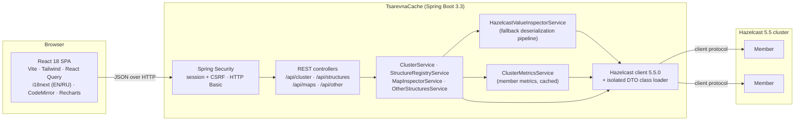

# TsarevnaCache

**A lightweight administration, monitoring and data inspection console for Hazelcast 5.5 clusters.**

TsarevnaCache connects to an existing cluster as a regular Hazelcast client and gives you a secured
web UI plus a REST API to watch members and memory, browse every distributed data structure and
read, edit or delete IMap entries — including entries whose Java classes the admin service has
never seen.


> **Non-commercial software.** TsarevnaCache is licensed under the
> [PolyForm Noncommercial License 1.0.0](LICENSE). Commercial use requires prior written permission
> from the author. See [License](#license).

---

## Contents

- [Project overview](#project-overview)
- [Features](#features)
- [Architecture](#architecture)
- [How custom DTO deserialization works](#how-custom-dto-deserialization-works)
- [Working with Custom DTOs (Two Approaches)](#working-with-custom-dtos-two-approaches)
- [Healthcheck & Best Practices Analyzer](#healthcheck--best-practices-analyzer)
- [Getting started](#getting-started)
- [Configuration](#configuration)
- [REST API](#rest-api)
- [Localization (EN / RU)](#localization-en--ru)
- [Development](#development)
- [Security notes](#security-notes)
- [Limitations](#limitations)
- [License](#license)

---

## Project overview

Hazelcast Management Center is powerful but heavy, and the open source Hazelcast distribution
ships without a data browser. Day-to-day questions — *"what is actually stored under this key?"*,
*"which map eats the memory?"*, *"why does this value not deserialize?"* — usually end in ad-hoc
client code.

TsarevnaCache answers them from a single self-contained jar:

- It runs **next to** your cluster as a Hazelcast client; nothing is installed on the members.
- It **never crashes on unknown data**: values whose classes, factories or serializers are missing
  are shown with a precise explanation instead of an error page.
- It is **safe for large maps**: it never calls `entrySet()` or `values()` without limits and pages
  through data with cost proportional to the page size.
- The UI is a dark, GitKraken-inspired single-page application available in **English and
  Russian**.

## Features

**Cluster & memory monitoring**
- Connection status (Online/Offline), cluster name, client and cluster versions.
- Members with address, UUID, master and lite-member flags, Hazelcast version, JVM heap and uptime.
- Totals over all maps: entries, owned and backup entry memory; top 5 heaviest maps (chart and table).

**Data structures registry**
- All distributed objects grouped by type: `IMap`, `ReplicatedMap`, `MultiMap`, `IQueue`, `ISet`,
  `IList`, `ITopic`, Reliable Topic, `FlakeIdGenerator`.
- Sidebar tree with name filter and size / memory badges; Hazelcast internal objects (`__*`) on demand.

**IMap inspector & CRUD**
- Data browser with three modes: all entries (cursor paging), exact key lookup (String, Long,
  Integer, UUID, JSON or a custom class key) and Hazelcast **SQL predicates**
  (e.g. `age > 25 AND active = true`).
- Table with key, key type, value preview, memory cost, hits and TTL / expiration.
- **Entry Inspector** drawer: JSON editor with syntax highlighting, `EntryView` metadata (cost,
  creation / update / access / store times, version, hits, TTL, max idle), *Save (put)* with an
  optional TTL and *Delete*.
- *Put Entry* dialog with key and value types (`STRING`, numbers, `BOOLEAN`, `UUID`, `BIG_DECIMAL`,
  `JSON` → `HazelcastJsonValue`, `CLASS` → your DTO), TTL in seconds.
- Editing **Compact records without their Java class** (the schema of the stored value is reused).
- **DTO Schema Studio**: paste `DataSerializableFactory.java` and your `IdentifiedDataSerializable`
  DTOs, review the parsed field order in a visual editor, and their values are read, edited and
  created as JSON — byte-identical, without any jar and without a restart.
- *Evict All* and *Clear Map* (the map name has to be typed to confirm).
- **Memory & Performance Stats**: `LocalMapStats` aggregated over all members — owned / backup
  entries and memory, heap cost, Merkle trees cost, hits, get / put / set / remove counts and
  latencies, events, evictions, expirations, queries, near cache statistics and a per-member breakdown.

**Healthcheck & advisor**
- Seven best practice rules (single member, unbounded maps without TTL, write-only maps, missing
  backups, high latency, queue backlogs, DTOs without schema) checked every minute and on demand.
- Health score in the top bar, issue cards with the current values, a recommendation and a link to
  the affected structure; ignore list with reasons (`config/healthcheck-ignores.json`).
- Prometheus exporter for the score, issue counts and map sizes.

**Other structures**
- Size and the first 50 items of queues, sets, lists, multimaps and replicated maps; remove single
  items or clear the structure.

**Platform**
- Single built-in administrator account, session login for the UI, HTTP Basic for scripts.
- English (default) and Russian UI; the choice is remembered per browser.
- One executable jar: the UI is built by Maven and served by Spring Boot.

## Architecture



**Backend** (`src/main/java/io/github/noproblem2000/tsarevnacache`)

| Package | Responsibility |
|---|---|
| `config` | Hazelcast client (`HazelcastClientConfig`), isolated `DtoClassLoader`, SPA resource handling, configuration properties |
| `security` | Session login, cookie based CSRF for the SPA, HTTP Basic, JSON 401/403 bodies |
| `inspector` | `HazelcastValueInspectorService`: reading and writing keys/values, `GenericRecord` support, Compact record builder, unresolved object analysis, key references |
| `maps` | `MapInspectorService`: statistics, cursor scan, SQL predicate paging, entry views, put / delete / evict / clear |
| `metrics` | `ClusterMetricsService`: per-member metrics read through the Management Center client protocol |
| `cluster`, `structures` | Cluster overview, distributed object registry, queues / sets / lists / multimaps / replicated maps |
| `api` | REST controllers, DTOs, error codes and the global exception handler |

**Frontend** (`frontend/src`): `api` (typed client and DTO mirrors), `auth`, `components`
(layout, UI kit, charts, JSON editor), `features` (data browser, inspector, statistics, structures),
`pages`, `i18n`.

### Design decisions

- **Raw protocol reads.** IMap reads use the client protocol at the level of serialized `Data`
  (`MapFetchKeys`, `MapKeySetWithPagingPredicate`, `MapGetEntryView`). Every key and value is then
  decoded individually by the inspector, so one undecodable entry cannot break a page.
- **Cursor paging for unfiltered browsing.** A `PagingPredicate` without a filter makes the members
  scan and sort the whole map for every page. The unfiltered browser therefore iterates partitions
  with an opaque cursor; its cost is proportional to the page size. SQL predicate searches use
  `Predicates.sql(...)` wrapped in `Predicates.pagingPredicate(...)` as usual.
- **Statistics from member metrics.** Hazelcast clients cannot call `IMap.getLocalMapStats()`.
  Members publish their metrics (map, queue, multimap, replicated map statistics, JVM heap) for
  Management Center; TsarevnaCache reads the newest sample of every member with the same client
  message (`MCReadMetricsCodec`) and caches it for a few seconds.
- **Key references.** Every listed entry carries a `keyRef` — the URL-safe Base64 of the serialized
  key. Get, put and delete accept it, which addresses the exact stored key even when its class is
  unknown to the admin service.
- **Writes without reading old values.** Puts use `IMap.set` and deletes `IMap.delete`, so old values
  that cannot be decoded never get in the way.
- **Nothing is created by accident.** Requests for unknown maps or structures return 404 instead of
  silently creating an empty distributed object.

## How custom DTO deserialization works

Clusters usually hold more than strings and numbers: Compact records, `IdentifiedDataSerializable`
objects, Portable objects, plain `Serializable` classes or values written by custom serializers —
and the admin service rarely has all those classes. `HazelcastValueInspectorService` reads every
binary through a fallback pipeline:

1. **`GenericRecord` (Compact / Portable).** Compact data whose class is not on the classpath is
   returned by the client as a `GenericRecord`; Portable data without a factory is too, whenever the
   class definition is known. The inspector renders the fields as JSON and returns the schema
   (field names and kinds, nested records). Compact values can be edited and written back as a
   `GenericRecord` with the same schema, so the owning application reads them as usual.
2. **`HazelcastJsonValue` and primitives.** JSON documents, strings, numbers, booleans and UUIDs
   are returned natively; their type is preselected when the value is edited.
3. **POJOs / DTOs on the classpath.** Other objects are converted by a dedicated Jackson
   `ObjectMapper` that binds **fields of any visibility** and ignores getters and setters. DTOs
   without getters, without `Serializable`, with private or final fields, records and `java.time`
   types all render. Objects that cannot be turned into JSON fall back to their `toString()` with a
   warning flag.
4. **Unresolvable binaries.** If the class, factory or serializer is missing, the request does not
   fail. The value is returned as an `UnresolvedObjectDTO`:

   ```json
   {
     "deserialized": false,
     "errorCode": "CLASS_NOT_FOUND",
     "reason": "ClassNotFoundException: com.example.billing.Invoice",
     "missingClass": "com.example.billing.Invoice",
     "typeId": -100,
     "serializer": "Java Serializable",
     "serializedSize": 412,
     "entryCost": 480,
     "metadata": { "className": "com.example.billing.Invoice" }
   }
   ```

   `errorCode` is one of `CLASS_NOT_FOUND`, `INCOMPATIBLE_CLASS`,
   `DATA_SERIALIZABLE_FACTORY_MISSING`, `PORTABLE_FACTORY_MISSING`, `CUSTOM_SERIALIZER_MISSING`,
   `COMPACT_SCHEMA_UNAVAILABLE`, `DTO_SCHEMA_MISSING` (an `IdentifiedDataSerializable` of a Studio
   factory without a schema; `metadata.missingClassId` names exactly the class that is missing,
   `metadata.nested` tells whether it is a DTO inside a registered root), `DTO_FIELD_READ_ERROR`
   (all schemas exist but one field does not match the bytes; `metadata.failedClassId`,
   `fieldOrder`, `fieldName`, `fieldType`) or `DESERIALIZATION_ERROR` and is translated by the UI. The
   `metadata` is read from the binary header: the class name of Java `Serializable`,
   `Externalizable` and non-identified `DataSerializable` objects, the factory and class ids of
   `IdentifiedDataSerializable` and Portable objects, the schema id of Compact data. `entryCost` comes
   from `EntryView.getCost()`.

**Writing values (`POST /api/maps/{map}/entry`)** — the request carries `key` + `keyType` (or a
`keyRef`), `value` + `valueType` and an optional `ttlSeconds`:

| `valueType` | Stored as |
|---|---|
| `STRING`, `INTEGER`, `LONG`, `SHORT`, `BYTE`, `DOUBLE`, `FLOAT`, `BOOLEAN`, `UUID`, `BIG_DECIMAL`, `BIG_INTEGER` | the matching Java type (range checked) |
| `JSON` | `HazelcastJsonValue` — queryable with SQL predicates without any class |
| `CLASS` | JSON bound by Jackson to `valueClassName` (classes without a no-arg constructor are allocated without one and filled field by field) |
| `COMPACT` | a Compact `GenericRecord` built from JSON and `valueSchema` |
| `IDENTIFIED_DTO` | an `IdentifiedDataSerializable` written by its DTO Schema Studio schema (`valueClassId` + optional `valueFactoryId`, or `valueClassName`) |

`ttlSeconds`: omitted → the map's default TTL; `0` → never expire; `n` → `n` seconds.

**Making your classes available** is described in
[Working with Custom DTOs (Two Approaches)](#working-with-custom-dtos-two-approaches).

## Working with Custom DTOs (Two Approaches)

Hazelcast stores your objects in binary form. To show them as JSON and to write them back, the admin
service must know how they are laid out. There are two ways to teach it, and they can be combined:

| | Approach 1: DTO Schema Studio | Approach 2: jars in `lib/` |
|---|---|---|
| Works for | `IdentifiedDataSerializable` DTOs written field by field (e.g. with `SerializationUtils` helpers) | every format: `Serializable`, `DataSerializable`, `IdentifiedDataSerializable`, Portable, Compact serializers, custom `StreamSerializer`s |
| You provide | the Java **source text** of the factory and the DTOs (copy & paste) | compiled **jar files** |
| Dependencies | none | the DTO jar plus every library its classes reference |
| Changes take effect | immediately after *Save Schema* (no restart) | after a restart of the service |
| Shared via | `config/dto-schemas.json` (export / import, commit to git) | the jar files |

Classes the admin service can read through neither approach are never a dead end: the inspector
shows them as *Not deserializable* with the reason, the class (or factory / class id) that is
missing and the size of the binary.

### Approach 1 (Recommended — Zero Dependencies): Built-in DTO Schema Studio

Most Hazelcast projects implement their DTOs as `IdentifiedDataSerializable` with one
`DataSerializableFactory` (`FACTORY_ID = 1`) and a `SerializationUtils` helper class:

```java
public class SomeDTO implements IdentifiedDataSerializable {
    private Long id;
    private String name;
    private Some2DTO details;
    private List<Some2DTO> items;
    private int version;

    @Override public int getFactoryId() { return DataSerializableFactory.FACTORY_ID; }
    @Override public int getClassId()   { return DataSerializableFactory.SOMEDTO; }

    @Override
    public void readData(ObjectDataInput in) throws IOException {
        this.id      = SerializationUtils.readNullableLong(in);
        this.name    = SerializationUtils.readNullableString(in);
        this.details = SerializationUtils.readNullableObject(in);
        this.items   = SerializationUtils.readNullableList(in);
        this.version = in.readInt();
    }
    // writeData writes the same fields in the same order
}
```

The bytes of such an object are completely described by **the order of the `readData` calls and the
helper used for each field**. The admin service ships a byte-exact copy of the helpers, so the
classes themselves are not needed: a schema is enough.

**Step by step**

1. Open **DTO Schemas** in the left sidebar (the badge shows how many classes are registered).
2. Click **Smart Java Paste**, choose **DataSerializableFactory.java**, paste the whole source of
   your factory (or *Open .java file*) and press **Parse Factory IDs**. `FACTORY_ID`, every `int`
   constant (`SOMEDTO = 1`, `SOME2DTO = 2`, …) and the class created for each id are stored. The
   parser understands `switch` expressions (`case SOMEDTO -> new SomeDTO()`), classic
   `case X: return new Y();`, constructor arrays (`constructors[X] = arg -> new Y()`) and
   `map.put(X, Y::new)`. The *Factory* panel then lists every class id and whether it already has a
   schema.
3. Switch to **DTO class**, paste `SomeDTO.java` and press **Analyze Java Code**. The parser walks
   `readData` (or `writeData` when `readData` delegates elsewhere), maps every call to a
   serialization type and opens the **visual schema editor** with the result:
   - *Factory ID*, *Class ID* and *Class Name*. The class id is taken from the constant returned by
     `getClassId()`, else from the class the factory creates (`case SOMEDTO -> new SomeDTO()`); names
     are matched without regard to case and underscores (`SomeDTO`, `SOMEDTO`, `SOME_DTO`). When
     neither works the field stays **empty** and has to be chosen (a factory constant, or the id of the
     value you came from) — the parser never falls back to a default id;
   - one row per field **in byte order** — reorder with *Move Up* / *Move Down*, add or remove rows;
   - the *Serialization Type* of each field (`NullableLong`, `NullableString`, `NullableDate`,
     `NullableObject`, `NullableBoolean`, `NullableInt`, `NullableDouble`, `NullableBigDecimal`,
     `NullableList`, `NullableLongList`, `NullableIntegerList` or a raw `in.readInt()`,
     `in.readLong()`, `in.readBoolean()`, `in.readString()`, `in.readByteArray()`);
   - the *Nested DTO Class* of `NullableObject` / `NullableList` fields (e.g. `Some2DTO`), taken from
     the field's declared type.

   Everything the parser could not map with certainty (control flow in `readData`, unknown calls,
   a `writeData` that disagrees with `readData`) is listed as a warning above the table. *Preview
   JSON* shows the JSON shape the schema produces.
4. Press **Save Schema**. The schema is written to `config/dto-schemas.json` and used at once: open a
   map and its `SomeDTO` values appear as JSON (type *Registered DTO*), can be edited in the Entry
   Inspector and are written back **byte-identical** to what your application writes.
5. Repeat step 3 for every DTO, nested ones included, **in any order**. A parent may be added before
   its nested classes: its `nestedClassName` is kept, and the `nestedClassId` is filled in from the
   factory mapping right away or, at the latest, when the nested class is saved (every save links all
   schemas again). Every schema is stored under its own `factoryId:classId`; saving never removes
   another schema, and the editor warns (*Replace Schema*) before a save would replace the schema
   stored under the same ids.

**When a value cannot be read** the map page and the Entry Inspector say precisely why:

- *Root DTO `SomeDTO (classId: 1)` cannot be read because nested DTO `classId: 2 (Some2DTO)` is not
  registered* — the button **Configure Missing DTO (classId: 2)** opens the Studio for the nested
  class, not for the registered root;
- *DTO `UnknownDTO (classId: 3)` is not registered* — **Configure Missing DTO (classId: 3)**;
- *Deserialization error in `SomeDTO (classId: 1)` at field #3 `field3` (`NULLABLE_STRING`). Check
  field order/types in schema* — all schemas exist, but the layout does not match the bytes;
  **Edit Schema (classId: 1)** opens that schema.

Saving, deleting or importing schemas refreshes the open map pages and re-runs the healthcheck at
once, so fixed values and the *Unregistered DTO* check update without waiting for the next minute.

**Importing a whole model folder.** You do not have to paste the classes one by one. In *Smart
Java Paste* use **Open .java Files** (select hundreds of files with `Ctrl+A` / `Shift+Click`),
**Select Folder** (the whole `model` package, subfolders included) or simply **drag and drop**
files or folders onto the dialog. One file opens in the editor as before; several files are read in
the browser in parallel and imported in one request (`POST /api/schemas/batch-import-java`) in three
passes, so the order of the files never matters:

1. **Factory first** — a class with `FACTORY_ID` and `create(int typeId)` is parsed and stored, so
   every class id is known before any DTO is read;
2. **Filter and parse** — enums, interfaces, records, abstract classes and plain classes such as
   `CustomRequest` / `CustomResponse` that do not implement `IdentifiedDataSerializable` (or
   `IdentifiedDataDTO`) or lack `readData`/`writeData` and `getClassId()` are skipped as
   *Not a Hazelcast IdentifiedDataSerializable DTO*; DTOs whose class id the factory does not create
   are skipped as *Not registered in DataSerializableFactory*; all others are parsed;
3. **Save and link** — the schemas are saved in one step and `nestedClassId` of every
   `NullableObject` / `NullableList` field is resolved by class name across the whole registry.
   The healthcheck runs once afterwards.

The summary shows **Imported: N DTO Schemas** (added or updated, with class ids), fields that need a
review, and a collapsed **Ignored: M non-DTO files** list with the reason for each file.

**Creating values.** In *Put Entry* choose the value type **Registered DTO (IdentifiedDataSerializable)**,
pick the class (e.g. `SomeDTO (classId: 1)`) and press **Generate JSON Template**: every field,
nested DTOs included, is filled with a sample value.

**JSON conventions.** Nested DTOs carry `"@classId"` (and `"@factoryId"` when it is not the project
factory); the top-level object has no markers. Dates are ISO-8601 (epoch milliseconds are accepted
too), `BigDecimal`s and longs beyond ±2^53 are strings so no digit is lost, `byte[]` is base64.
Nested values that are neither DTOs, strings nor booleans keep their Java type as
`{"@javaType": "java.lang.Integer", "value": 5}`.

**`config/dto-schemas.json` and the team.** The file holds two independent parts: the factory
mapping (`factoryId`, `factoryConstants`, `factoryClasses`) and the schemas (including the pasted
source of each DTO). Deleting schemas — even all of them — keeps the factory mapping; only parsing a
factory again replaces it. Its location is `admin.dto-schemas.file`
(`DTO_SCHEMAS_FILE`, default `./config/dto-schemas.json`, i.e. the `config/` folder of the
distribution). Share it like any other configuration:

- **Export JSON** downloads the whole registry; each schema card also has its own *Export JSON*.
- **Import JSON** uploads such a file — *Merge* adds / overwrites schemas with the same ids,
  *Replace all* makes the schemas identical to the file (the factory mapping is replaced only when
  the file contains one, so importing a single exported schema keeps the parsed factory).
- Or simply commit `dto-schemas.json` next to your DTOs and copy it into `config/` of every
  installation; it is read on start.

**Factory ids.** Values of the factory ids in `admin.hazelcast.serialization.dynamic-factory-ids`
(default `[1]`) are decoded by the Studio from the start. Schemas of another factory id are saved
at once but become readable after the next restart (the card shows *Restart needed*), because
Hazelcast clients register factories only when they start.

### Approach 2 (Alternative): External JAR in `lib/` folder

Use this for formats the Studio cannot describe — Java `Serializable` / `Externalizable` classes,
`DataSerializable` without ids, Portable factories, custom `StreamSerializer`s — or when your DTOs
are already published as a jar.

1. **Get a jar with the classes.** Take the jar your application already publishes (e.g.
   `my-app-dto-1.4.2.jar` from your Maven repository) or build a lightweight one that contains only
   the model package:

   ```xml
   <!-- in the module with your DTOs -->
   <plugin>
     <groupId>org.apache.maven.plugins</groupId>
     <artifactId>maven-jar-plugin</artifactId>
     <executions>
       <execution>
         <id>dto-jar</id>
         <goals><goal>jar</goal></goals>
         <configuration>
           <classifier>dto</classifier>
           <includes><include>com/example/model/**</include></includes>
         </configuration>
       </execution>
     </executions>
   </plugin>
   ```

   or, with plain JDK tools: `jar cf my-dto.jar -C target/classes com/example/model`.
2. **Copy it into `lib/`** of the distribution, next to `HazelcastInspector.exe`:

   ```text
   hazelcast-inspector-<version>/
   ├── HazelcastInspector.exe
   ├── bin/start.sh, bin/start.bat
   ├── config/application.yml
   └── lib/
       ├── my-app-dto-1.4.2.jar
       └── joda-money-1.0.4.jar      ← libraries referenced by the DTOs
   ```

3. **Add the dependencies the classes need.** Everything a DTO references while it is deserialized
   must be on the classpath as well: field types from other libraries (e.g. `org.joda.money.Money`),
   base classes and enums from other modules, the classes your factory instantiates. Hazelcast itself,
   Jackson and Spring are already provided by the admin service — do not copy them. `mvn
   dependency:copy-dependencies -DincludeScope=runtime -DexcludeGroupIds=com.hazelcast` collects the
   rest. A missing class is reported as `CLASS_NOT_FOUND` with its name.
4. **Restart the service** — `HazelcastInspector.exe`, `bin\start.bat` or `bin/start.sh`. All of
   them start the jar with `-Dloader.path=lib/` from the distribution root, so every jar in `lib/` is
   on the classpath.

**Automatic registration.** On start, the service scans the jars in `lib/` (and
`admin.hazelcast.serialization.dto-classpath`) for public classes whose name contains `Factory`
that implement `DataSerializableFactory` or `PortableFactory` and declare a `static int FACTORY_ID`
constant (directly or through an implemented interface) — the usual Hazelcast convention. They are
registered under that id; the log says `Discovered DataSerializableFactory 1 -> com.example...` and the
Studio's *Storage & factories* panel lists them. Plain `Serializable` classes need no registration
at all. Explicit configuration wins over discovery and is needed for anything without a
`FACTORY_ID` constant or for custom serializers:

```yaml
# config/application.yml
admin:
  hazelcast:
    serialization:
      auto-register-factories: true        # default
      dto-classpath:                       # optional extra jars / directories outside lib/
        - /opt/tsarevna/dto-libs
      data-serializable-factories:
        1000: com.example.serialization.BillingDataSerializableFactory
      portable-factories:
        2000: com.example.serialization.LegacyPortableFactory
      compact-serializers:
        - com.example.serialization.MoneyCompactSerializer
      custom-serializers:
        - type-class: com.example.Money
          serializer-class: com.example.serialization.MoneyStreamSerializer
```

With the classes on the classpath, values are shown field by field (kind *Object*) and can be written
with the value type **Custom class** (`CLASS`) and the fully qualified class name.

**Combining both approaches.** When a jar factory and Studio schemas use the same factory id (e.g. 1),
schemas win and the jar factory handles every class id without a schema. So you can start with the
Studio and add a jar later, or the other way round.

## Healthcheck & Best Practices Analyzer

Like the health checks of the Hazelcast Management Center, a built-in analyzer inspects the cluster,
its maps and queues **every minute** (`@Scheduled`) and on demand (**Run Check Now** on the
*Healthcheck* screen, `POST /api/healthcheck/run`). The top bar shows the result next to the
connection status (`92% · Healthy`, `2 Warnings`, `1 Critical`); a click opens the screen.

### Rules

| Rule (`checkType`) | Severity | Fires when |
|---|---|---|
| `CLUSTER_SINGLE_MEMBER` | WARNING | the cluster has exactly one data member — no fault tolerance, partition backups have nowhere to live |
| `MAP_UNBOUNDED_NO_TTL` | WARNING, CRITICAL above 250 MB | a map has more than 1 000 entries or more than 50 MB owned memory and **every sampled entry** has neither TTL nor max idle (stored forever, risk of `OutOfMemoryError`) |
| `MAP_ZOMBIE_WRITE_ONLY` | WARNING | more than 100 entries and put/set operations, but `getOperationCount == 0` and `hits == 0` since the members started ("dead cache") |
| `MAP_BACKUP_DISABLED_OR_BROKEN` | CRITICAL | at least 2 data members, `ownedEntryCount > 0` but `backupEntryCount == 0` (`backup-count: 0` — a member failure loses data) |
| `MAP_HIGH_LATENCY` | WARNING | `totalGetLatency / getOperationCount` or `totalPutLatency / putOperationCount` above 25 ms (after at least 50 operations) |
| `QUEUE_BACKLOG_GROWTH` | WARNING | an `IQueue` holds more than 5 000 items |
| `DTO_UNREGISTERED_SCHEMA` | WARNING, INFO | sampled values are `IdentifiedDataSerializable` objects without a DTO schema — WARNING when a schema in the [DTO Schema Studio](#approach-1-recommended--zero-dependencies-built-in-dto-schema-studio) makes them readable at once, INFO when their factory id additionally needs a restart |

Map statistics come from the member metrics (the same numbers as *Memory & Performance Stats*).
TTL / max idle and unregistered DTOs are checked on a sample of `sample-size` entries (20) of the
`max-sampled-maps` largest maps (100). All thresholds are configurable (`admin.healthcheck.thresholds.*`).

Every finding is a `HealthCheckIssue`:

```json
{
  "issueId": "MAP_UNBOUNDED_NO_TTL:user_sessions",
  "checkType": "MAP_UNBOUNDED_NO_TTL",
  "severity": "CRITICAL",
  "targetType": "IMAP",
  "targetName": "user_sessions",
  "currentValue": "entries=1200000, memory=450.0 MB, ttl=infinite, maxIdle=infinite (20 of 20 sampled entries)",
  "recommendationCode": "MAP_UNBOUNDED_NO_TTL_CRITICAL",
  "detectedAt": "2026-10-29T10:00:00Z",
  "details": { "entries": 1200000, "memoryBytes": 471859200, "sampled": 20, "withoutExpiry": 20 }
}
```

`issueId` is deterministic (`<checkType>:<target>`, DTOs: `DTO_UNREGISTERED_SCHEMA:<factoryId>:<classId>`)
and `detectedAt` keeps the time of the first run that found the issue. The UI translates the rule
and the recommendation (`recommendationCode`) and links the target: the map's data browser or
statistics, the queue, or the DTO Schema Studio with the ids pre-filled.

**Health score.** `100 − 25 × critical − 10 × warning` active issues (never below 0); INFO issues
and ignored issues do not count. Status: `CRITICAL` with any critical issue, `DEGRADED` with a
warning, `HEALTHY` otherwise. When the cluster cannot be reached the score is 0 and the status
`CRITICAL`.

### Ignore list

A finding that does not apply — e.g. a reference map that intentionally never expires — is hidden
with **Ignore Check**, for this target (`MAP_UNBOUNDED_NO_TTL:countries`) or for the whole rule
(`MAP_UNBOUNDED_NO_TTL:*`), with a reason. The list is stored in `config/healthcheck-ignores.json`
(`admin.healthcheck.ignores-file`), applies at once without a new run and can be shared like
`dto-schemas.json`. Hidden issues are listed under **Ignored Rules** with a **Restore** button.

### Prometheus

`GET /api/healthcheck/prometheus` serves the latest run in the text exposition format 0.0.4
(`text/plain; version=0.0.4`):

```text
hazelcast_inspector_health_score 90
hazelcast_inspector_health_issues_total{severity="CRITICAL"} 0
hazelcast_inspector_health_issues_total{severity="WARNING"} 1
hazelcast_inspector_health_issues_total{severity="INFO"} 0
hazelcast_inspector_health_ignored_issues_total 1
hazelcast_inspector_cluster_up 1
hazelcast_inspector_health_last_run_timestamp_seconds 1861600000.000
hazelcast_inspector_map_entries_total{map="user_sessions"} 1200000
hazelcast_inspector_map_memory_bytes{map="user_sessions",type="owned"} 471859200
hazelcast_inspector_map_memory_bytes{map="user_sessions",type="backup"} 471859200
```

Like every `/api` endpoint it requires the administrator; Prometheus authenticates with HTTP Basic:

```yaml
scrape_configs:
  - job_name: hazelcast-inspector
    metrics_path: /api/healthcheck/prometheus
    scrape_interval: 60s
    basic_auth:
      username: admin
      password: <ADMIN_PASSWORD>
    static_configs:
      - targets: ['inspector.example.com:8080']
```

The *Prometheus Metrics URL* button on the Healthcheck screen shows the URL, this snippet and a
live preview.

## Getting started

### Requirements

- **Java 17 or newer** to run it (a JDK to build it; the build uses the Maven Wrapper, no Maven
  installation needed).
- A reachable **Hazelcast 5.5** cluster (open source / Slim is fine).
- Node.js is **not** required: the build downloads a portable Node 20 into `frontend/node`.

### Standalone distribution (recommended)

Download `hazelcast-inspector-<version>-release.zip` (or `.tar.gz`) from the **Releases** page — or
build it yourself with `./mvnw clean package -Prelease` (output in `target/`). The archive contains
everything needed to run the service:

```
hazelcast-inspector-<version>/
├── HazelcastInspector.exe      Windows launcher - starts java.exe directly, no cmd.exe
├── HazelcastInspector.l4j.ini  extra JVM options for the .exe (optional)
├── hazelcast-inspector.jar     backend + web UI in one executable jar
├── config/application.yml      cluster members, admin credentials, serializers
├── lib/                        drop jars with your DTO classes here
├── bin/start.sh                Linux / macOS
├── bin/start.bat               Windows (script)
├── LICENSE
└── README.md
```

1. Unpack the archive.
2. Edit `config/application.yml`: `admin.hazelcast.cluster-name`, `admin.hazelcast.members` and
   **`admin.security.password`** (or set `HZ_CLUSTER_NAME`, `HZ_MEMBERS`, `ADMIN_PASSWORD`).
3. Optionally copy jars with your DTO classes (and factories/serializers) into `lib/`.
4. Start it and open <http://localhost:8080>:

| Platform | Start with |
|---|---|
| Windows | double-click **`HazelcastInspector.exe`** (or run it from a console) |
| Windows, scripts allowed | `bin\start.bat` |
| Linux / macOS | `bin/start.sh` |

All three launchers start the service the same way: working directory = the distribution root,
`-Xms256m -Xmx1024m`, G1, fail-fast on OOM, the module flags Hazelcast recommends,
`-Dloader.path=lib/` (your DTO jars) and
`--spring.config.location=optional:classpath:/,optional:file:./config/` (built-in defaults, then
`config/application.yml`). Extra Spring Boot arguments are passed through
(e.g. `bin/start.sh --server.port=9090`). Extra JVM options go into `JAVA_OPTS` for the scripts
(e.g. `JAVA_OPTS=-Xmx2g`) and into `HazelcastInspector.l4j.ini` (one option per line) for the `.exe`.

### Windows launcher (`HazelcastInspector.exe`)

Some corporate environments block script interpreters (`cmd.exe`, PowerShell) but allow compiled
executables. `HazelcastInspector.exe` is a small console launcher generated by
[Launch4j](https://launch4j.sourceforge.net/) (`launch4j-maven-plugin`, `dontWrapJar`): it starts
`java.exe` directly with `CreateProcess` — no shell involved — next to the unchanged
`hazelcast-inspector.jar`.

- **Java lookup:** `jre\` next to the exe (unpack a JRE there to ship a fully self-contained
  folder), then `JAVA_HOME`, then `PATH`; Java 17+ 64-bit is required.
- **Console:** Spring Boot logs appear in the launcher's window; `Ctrl+C` or closing the window stops
  the service gracefully.

Each GitHub release additionally provides **`HazelcastInspector-native.exe`**, the same launcher as a
17 KB plain Win32 C program ([`src/launcher/launcher.c`](src/launcher/launcher.c)). It behaves
identically and additionally puts Java into a job object, so Java is also stopped when the launcher
process is killed (e.g. "End task"). To use it, rename it to `HazelcastInspector.exe` and replace
the one in the unpacked folder. Build it yourself with mingw-w64:

```bash
src/launcher/build-native.sh 1.0.1 target/HazelcastInspector-native.exe
```

A C# variant ([`src/launcher/Program.cs`](src/launcher/Program.cs),
[`HazelcastInspector.csproj`](src/launcher/HazelcastInspector.csproj)) is included for teams that
prefer .NET tooling (`dotnet publish src/launcher/HazelcastInspector.csproj -c Release -r win-x64`).

### Build and run from source

```bash
./mvnw clean package
```

```bash
ADMIN_USERNAME=admin ADMIN_PASSWORD='change-me' HZ_CLUSTER_NAME=dev HZ_MEMBERS=10.0.0.11:5701,10.0.0.12:5701 java -jar target/tsarevna-cache-0.1.0-SNAPSHOT.jar
```

Open <http://localhost:8080> and sign in with the configured account. On Windows use
`mvnw.cmd` and set the variables with `set` (cmd) or `$env:NAME = "value"` (PowerShell).

The service also starts while the cluster is down: the UI shows *Offline* and the client keeps
reconnecting in the background.

### Try it with a local test member

```bash
java -cp ~/.m2/repository/com/hazelcast/hazelcast/5.5.0/hazelcast-5.5.0.jar com.hazelcast.core.server.HazelcastMemberStarter
```

This starts a member with the default configuration (cluster name `dev`, port 5701), which matches
TsarevnaCache's defaults. The Hazelcast jar is in your local Maven repository after the first build.

### Requirements on the cluster

- **Metrics** must be enabled on the members (default) including the Management Center consumer
  (`hazelcast.metrics.management-center.enabled`, default `true`). Statistics appear a few seconds
  after start-up (`hazelcast.metrics.collection.frequency`, default 5 s).
- If the members restrict Management Center requests with **trusted interfaces**
  (`management-center.trusted-interfaces`), include the address of the TsarevnaCache host.
- Per-entry **hits** and access times are only tracked when `per-entry-stats-enabled: true` is set
  on the map (disabled by default since Hazelcast 4.2); otherwise the UI shows "—".

## Configuration

All settings live in [`application.yml`](src/main/resources/application.yml) and can be overridden
by environment variables or any other Spring Boot property source.

### Administrator account — `admin.security.*`

| Property | Env variable | Default | Description |
|---|---|---|---|
| `admin.security.username` | `ADMIN_USERNAME` | `admin` | Login of the single administrator |
| `admin.security.password` | `ADMIN_PASSWORD` | `admin` | Plain text, or prefixed with an encoder id such as `{bcrypt}$2a$10$…` |
| `admin.security.cors.allowed-origins` | `ADMIN_CORS_ORIGINS` | *(empty)* | Comma separated origins allowed to call the API cross-origin; only needed when the UI is hosted elsewhere |
| `admin.security.login-throttle.max-failures` | | `10` | Failed logins per client address within the window before `POST /api/auth/login` answers `429` |
| `admin.security.login-throttle.window` | | `5m` | Sliding window for failed logins (and lockout duration) |

A warning is logged while the default credentials are in use.

### Hazelcast client — `admin.hazelcast.*`

| Property | Env variable | Default | Description |
|---|---|---|---|
| `cluster-name` | `HZ_CLUSTER_NAME` | `dev` | Cluster name of the members |
| `members` | `HZ_MEMBERS` | `127.0.0.1:5701` | Comma separated `host:port` list |
| `instance-name` | | `tsarevna-admin-client` | Client instance name |
| `labels` | | `[tsarevna-admin]` | Client labels visible to the members |
| `smart-routing` | | `true` | Connect to all members and route to partition owners |
| `connection-timeout` | | `5s` | Timeout of one connection attempt |
| `invocation-timeout` | | `60s` | Maximum time an invocation is retried |
| `heartbeat-interval` / `heartbeat-timeout` | | `5s` / `60s` | Client heartbeat settings |
| `async-start` | | `true` | Start without waiting for the cluster |
| `reconnect-mode` | | `ASYNC` | `ON`, `OFF` or `ASYNC` |
| `retry.initial-backoff` / `retry.max-backoff` | | `1s` / `30s` | Reconnect backoff bounds |
| `retry.multiplier` / `retry.jitter` | | `1.5` / `0.2` | Backoff growth and randomization |
| `retry.cluster-connect-timeout` | | *(unset = forever)* | Give up connecting after this period |
| `serialization.dto-classpath` | `HZ_DTO_CLASSPATH` | *(empty)* | Jars or directories with DTOs, factories and serializers |
| `serialization.compact-classes` | | `[]` | Classes registered for zero-config Compact serialization |
| `serialization.compact-serializers` | | `[]` | `CompactSerializer` implementations |
| `serialization.data-serializable-factories` | | `{}` | Factory id → `DataSerializableFactory` class |
| `serialization.dynamic-factory-ids` | | `[1]` | Factory ids served by the dynamic DTO schema registry |
| `serialization.portable-factories` | | `{}` | Factory id → `PortableFactory` class |
| `serialization.auto-register-factories` | | `true` | Register factories found in `lib/` / `dto-classpath` by their `FACTORY_ID` |
| `serialization.portable-version` | | `0` | Portable version of the admin client |
| `serialization.custom-serializers` | | `[]` | `type-class` / `serializer-class` pairs |

### Value inspector — `admin.inspector.*`

| Property | Default | Description |
|---|---|---|
| `preview-length` | `160` | Length of the single-line value preview in tables |
| `denied-class-prefixes` | `java.`, `javax.`, `jdk.`, `sun.`, `com.sun.`, `org.springframework.`, `com.hazelcast.`, `io.github.noproblem2000.tsarevnacache.` | Packages that cannot be used as `CLASS` targets when writing values |

### DTO schema registry — `admin.dto-schemas.*`

| Property | Env variable | Default | Description |
|---|---|---|---|
| `file` | `DTO_SCHEMAS_FILE` | `./config/dto-schemas.json` | Schemas of dynamic `IdentifiedDataSerializable` DTOs and the factory mapping |

### Healthcheck — `admin.healthcheck.*`

| Property | Env variable | Default | Description |
|---|---|---|---|
| `enabled` | `HEALTHCHECK_ENABLED` | `true` | Background runs (manual runs and the API work either way) |
| `interval-ms` / `initial-delay-ms` | | `60000` / `15000` | Period and first delay of the background runs |
| `ignores-file` | `HEALTHCHECK_IGNORES_FILE` | `./config/healthcheck-ignores.json` | Ignore list |
| `sample-size` / `max-sampled-maps` | | `20` / `100` | Entries read per map, maps sampled per run (largest first) |
| `thresholds.unbounded-min-entries` | | `1000` | `MAP_UNBOUNDED_NO_TTL`: map size |
| `thresholds.unbounded-warning-memory` / `thresholds.unbounded-critical-memory` | | `50MB` / `250MB` | `MAP_UNBOUNDED_NO_TTL`: owned memory for WARNING / CRITICAL |
| `thresholds.zombie-min-entries` | | `100` | `MAP_ZOMBIE_WRITE_ONLY`: minimum entries |
| `thresholds.latency-ms` / `thresholds.latency-min-operations` | | `25` / `50` | `MAP_HIGH_LATENCY`: average latency and operations needed |
| `thresholds.queue-backlog` | | `5000` | `QUEUE_BACKLOG_GROWTH`: queue size |

### Explorer limits — `admin.explorer.*`

| Property | Default | Description |
|---|---|---|
| `operation-timeout` | `15s` | Timeout of one cluster call issued by the explorer |
| `metrics-cache-ttl` | `3s` | How long member metrics are cached between UI refreshes |
| `max-page-size` | `200` | Largest page of the IMap data browser |
| `scan-parallelism` | `32` | Partitions scanned in parallel while filling an unfiltered page |
| `max-preview-items` | `50` | Items shown for queues, sets, lists, multimaps and replicated maps |
| `max-fetch-items` | `10000` | Queues, sets, multimaps and replicated maps larger than this show their size only (clients can only fetch them as a whole) |

### Server

| Property | Env variable | Default |
|---|---|---|
| `server.port` | `SERVER_PORT` | `8080` |
| `server.servlet.session.timeout` | | `30m` |

## REST API

All endpoints below `/api` require the administrator. Errors are returned as
`{ "timestamp", "status", "code", "message", "path", "details" }` with a stable `code`
(e.g. `MAP_NOT_FOUND`, `INVALID_PREDICATE`, `CLUSTER_UNAVAILABLE`).

| Method | Path | Description |
|---|---|---|
| `GET` | `/api/auth/csrf` | Issues the `XSRF-TOKEN` cookie |
| `POST` | `/api/auth/login` | Session login `{ "username", "password" }` |
| `GET` | `/api/auth/me` | Current user |
| `POST` | `/api/auth/logout` | Ends the session |
| `GET` | `/api/cluster/overview` | Connection state, members, totals, top maps |
| `GET` | `/api/structures?includeInternal=false` | Distributed objects grouped by type |
| `GET` | `/api/maps/{map}/stats` | Aggregated `LocalMapStats` and per-member breakdown |
| `GET` | `/api/maps/{map}/entries?size&cursor` | Unfiltered page; follow `nextCursor` |
| `GET` | `/api/maps/{map}/entries?searchKey&keyType&keyClassName` | Exact key lookup (or `keyRef`) |
| `GET` | `/api/maps/{map}/entries?sqlPredicate&page&size` | SQL predicate page |
| `GET` | `/api/maps/{map}/entry?key&keyType` or `?keyRef` | Value and `EntryView` metadata |
| `POST` | `/api/maps/{map}/entry` | Create or update an entry |
| `DELETE` | `/api/maps/{map}/entry?key&keyType` or `?keyRef` | Delete an entry |
| `POST` | `/api/maps/{map}/evict` | `IMap.evictAll()` |
| `DELETE` | `/api/maps/{map}/clear?confirm={map}` | `IMap.clear()` (the name must be repeated) |
| `GET` | `/api/other/{type}/{name}?limit=50` | Size and first items (`queue`, `set`, `list`, `multimap`, `replicatedmap`) |
| `DELETE` | `/api/other/{type}/{name}/item?ref&keyRef` | Remove one item |
| `DELETE` | `/api/other/{type}/{name}/clear?confirm={name}` | Clear the structure |
| `GET` | `/api/schemas` | Factory mapping, active / pending factory ids and all DTO schemas |
| `POST` | `/api/schemas/parse-factory?save=true` | Parse `DataSerializableFactory.java` `{ "source" }` |
| `POST` | `/api/schemas/parse-dto` | Parse a DTO class `{ "source" }` (preview, not saved) |
| `POST` | `/api/schemas/batch-import-java` | Import many `.java` files `[{ "fileName", "content" }]`: factory first, non-DTOs ignored, DTO schemas saved and linked; returns the import summary |
| `POST` | `/api/schemas` | Save a DTO schema |
| `DELETE` | `/api/schemas/{factoryId}/{classId}` | Delete a DTO schema |
| `GET` | `/api/schemas/export` | Download `dto-schemas.json` |
| `POST` | `/api/schemas/import?mode=replace\|merge` | Upload `dto-schemas.json` |
| `GET` | `/api/healthcheck/report` | Latest healthcheck: score, status, active and ignored issues |
| `POST` | `/api/healthcheck/run` | Run all checks now |
| `POST` | `/api/healthcheck/ignore` | Add `{ "issueId", "reason" }` to the ignore list (`CHECK_TYPE:*` = whole rule) |
| `DELETE` | `/api/healthcheck/ignore/{issueId}` or `?issueId=` | Remove an ignore list entry |
| `GET` | `/api/healthcheck/prometheus` | Prometheus metrics (`text/plain; version=0.0.4`) |

Scripts can use HTTP Basic; such requests are exempt from CSRF checks:

```bash
curl -u admin:change-me "http://localhost:8080/api/maps/users/entries?sqlPredicate=age%20%3E%2025&size=10"
```

## Localization (EN / RU)

- English is the default language; Russian is available from the `EN | RU` switch in the top bar.
  The choice is stored in the browser (`localStorage`).
- All texts — labels, tooltips, dialogs, metric descriptions, error messages and deserialization
  reasons — come from [`frontend/src/i18n/locales/en.json`](frontend/src/i18n/locales/en.json) and
  [`ru.json`](frontend/src/i18n/locales/ru.json). Russian plural forms are handled by i18next.
- The backend returns stable error codes; the UI translates them via the `errors.<CODE>` and
  `deserialization.<CODE>` keys.
- A unit test fails when the two dictionaries do not define the same keys or a backend error code is
  missing. To add a language, copy `en.json`, translate it and register it in
  [`frontend/src/i18n/index.ts`](frontend/src/i18n/index.ts).

## Development

```bash
./mvnw verify
```

Builds the UI (with its unit tests) and runs the backend test suite. The integration tests start an
embedded Hazelcast member and compile "hidden" DTOs at runtime that are visible to the member but
not to the admin client, covering every serialization mechanism. Skip the UI build with
`-Dfrontend.skip=true`.

Frontend development with hot reload (the backend must run on port 8080; `/api` is proxied):

```bash
cd frontend && npm run dev
```

Without a global Node installation, use the portable one downloaded by the build (run it from the
`frontend/` directory):

```bash
cd frontend && node/node node/node_modules/npm/bin/npm-cli.js run dev
```

### Releases

`./mvnw clean package -Prelease` builds the standalone archives
(`target/hazelcast-inspector-<version>-release.zip` and `.tar.gz`). `scripts/create-release.sh 1.0.0`
prepares a release branch, sets the version, builds and checks the archive, tags `v1.0.0` and pushes;
GitHub Actions (`.github/workflows/release.yml`) and GitLab CI (`.gitlab-ci.yml`) then publish the
archives as a release. Details: [`docs/RELEASING.md`](docs/RELEASING.md).

## Security notes

- **Change the default credentials** (`ADMIN_USERNAME`, `ADMIN_PASSWORD`) before exposing the
  service; prefer a `{bcrypt}` password and put the service behind TLS. Behind TLS also set
  `SERVER_SERVLET_SESSION_COOKIE_SECURE=true` so the session cookie is never sent over plain HTTP.
- The UI uses an HTTP-only, `SameSite=Strict` session cookie and a CSRF token; the browser never
  shows a Basic-auth dialog.
- Failed logins are throttled per client address (`admin.security.login-throttle.*`, in memory per
  instance). Behind a reverse proxy all requests share the proxy's address unless Spring Boot is told
  to trust forwarded headers (`server.forward-headers-strategy=native`).
- Responses carry a strict `Content-Security-Policy` (scripts, styles, fonts and API calls from the
  service's own origin only), `X-Frame-Options: DENY` and `Referrer-Policy: same-origin`.
- TsarevnaCache **deserializes data read from the cluster** (including Java serialization when the
  classes are on its classpath). Connect it only to clusters whose writers you trust.
- Writing `CLASS` values binds JSON to arbitrary classes on the DTO classpath; the packages in
  `admin.inspector.denied-class-prefixes` are excluded.

## Limitations

- Raw protocol access and metrics decoding use Hazelcast's internal client API and are pinned to
  **Hazelcast 5.5.0**; re-run the test suite when upgrading.
- Unfiltered browsing pages forward with a cursor (previous pages are kept in the UI); jumping to an
  arbitrary page number is only available for SQL predicate results.
- Queues, sets, multimaps and replicated maps can only be fetched as a whole by a client; above
  `max-fetch-items` only their size is shown.
- Compact values can be edited, but a new Compact value cannot be created from scratch in the UI
  (a schema is required).
- The DTO Schema Studio describes `IdentifiedDataSerializable` DTOs whose `readData` is a fixed
  sequence of reads; conditional or versioned layouts need a jar (Approach 2). Schemas of a new
  factory id become readable after a restart.
- Very large `long` numbers nested inside JSON values may lose precision in the browser; top-level
  numeric keys and values are transferred as text and stay exact.
- Exact-key search with key type `JSON` serializes the typed JSON in compact form; keys stored with
  different whitespace do not match. Open such entries from the table instead (rows address the
  stored key through its `keyRef`).

## License

TsarevnaCache is distributed under the **PolyForm Noncommercial License 1.0.0** — see
[`LICENSE`](LICENSE) for the full text.

In short (the license text is authoritative):

- ✅ Personal use, research, experimentation, testing and evaluation.
- ✅ Use by non-profit, educational, public research and government organizations.
- ✅ Modifying the software and sharing it under the same license terms, keeping the
  `Required Notice` line.
- ❌ Any **commercial use** — for example operating it for a company's business or as part of a
  paid product or service — **without prior written permission from the author**.

For commercial licensing, contact the author via
[GitHub](https://github.com/NoProblem2000).

Required Notice: Copyright (c) 2026 NoProblem2000 (https://github.com/NoProblem2000/TsarevnaCache)
